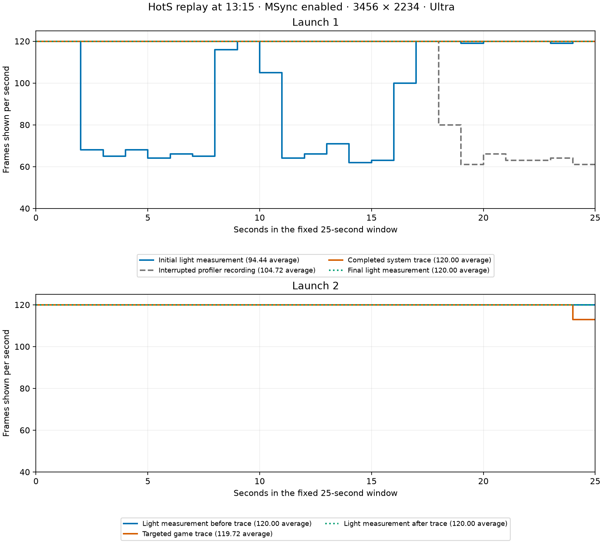

# HotS stutter tracing, 2026-10-19

**The exact cause of the frequent stutter is still unresolved.** A later,
independently time-validated trace localizes one isolated hitch to a gap in
requests for new frames. It does not reproduce the earlier multi-second
periods around 60–70 FPS or identify the responsible function.

All measurements use free Wine/DXMT, MSync enabled, 3456×2234, Ultra and the
120 FPS DXMT cap. The same replay is paused at 13:15, at Normal speed, following
player 3 Kerrigan. Each result covers the predetermined 25-second window
from +3 to +28 seconds after the play command. Seeking, screenshots and OCR
are outside that window. No native input automation or display-mode changes
were used. [Conditions](../results/stutter-trace-2026-10-19/conditions.json)
include the unchanged production-preferences hash.
Short instrumentation dry runs of four or six seconds are setup checks,
not additional qualified FPS samples.

| Launch / ordered pass | Recorder | Average FPS | 1% low FPS | Longest interval, ms | Intervals >12.5 ms |
|---|---|---:|---:|---:|---:|
| 1 / initial | Light probe | 94.44 | 54.34 | 33.33 | 634 |
| 1 / first trace attempt | Heavy profiler, interrupted before finalization | 104.72 | 48.72 | 66.67 | 368 |
| 1 / later control | Light probe | 119.96 | 116.13 | 16.67 | 1 |
| 1 / completed system trace | Profiler + probe | 120.00 | 120.00 | 8.33 | 0 |
| 1 / final control | Light probe | 120.00 | 120.00 | 8.33 | 0 |
| 2 / before trace | Light probe | 120.00 | 120.00 | 8.33 | 0 |
| 2 / targeted trace | Profiler + probe | 119.72 | 97.30 | 58.33 | 2 |
| 2 / after trace | Light probe | 120.00 | 120.00 | 8.33 | 0 |

The probe's actual presentation timestamps qualify all eight samples for
geometry, one onscreen layer, continuous foreground and the fixed window.
The interrupted attempt retains its presentation data, but has no finalized
CPU/GPU recording and is excluded from pipeline attribution. Counts denote
long presentation intervals, not lost physical refreshes; the display mode
and ProMotion setting were unchanged, but active refresh behavior was not
independently measured. The 1% low is the reciprocal of the mean of the slowest 1% of
complete intervals intersecting the window, including boundary intervals.

## What was observed

The first light pass contains two multi-second periods around 60–70 displayed
frames per second, separated by periods near 120. Its post-nextDrawable-to-
presentation p99 is 49.53 ms, versus 23–32 ms in the later light passes from
that launch. The timestamp is taken **after** `nextDrawable` returns. It does
not measure time blocked in that call or distinguish CPU, GPU and compositor
work. The exported acquisition gaps are explicitly between **shown** drawables.

No setting changed between these passes. Repetition, time since launch,
cache state, instrumentation and background conditions are confounded. This
does not prove that warming a cache fixes the issue. The second launch's first
light pass was already smooth after the same replay warm-up. Neither launch
is a cold-cache or full-match qualification.

The completed system trace used Time Profiler, Thread Activity, Metal
Application, Display, Thermal State and Frame Lifetimes with all-process
scope. Its exported display-swap table ends before the measured window, and
its Metal submission stream is sparse. It cannot support per-frame causal
analysis. Its separate probe measurement is retained rather than hidden.

The second recording reduces scope to the game PID and uses Time Profiler,
Metal Application, Frame Lifetimes and Thermal State, with waiting-thread
sampling disabled. **All 2,993 presented frames match 2,993 independent display
swaps in both directions, within 167.5 ns**, using the trace's absolute Mach
epoch and timebase. No fitted offset or rate is used.

## The isolated hitch in the targeted trace

The largest interval, 58.33 ms, ends at +24.595 seconds of the measured window.
The same traced window also contains a 16.67 ms interval. Neither light bracket
contains a >12.5 ms interval. The comparison rule, recorded after capture but
before deriving new frame metrics, flags excess when the traced long-interval
count exceeds `max(before, after) + abs(before - after)`. Here it is 2 versus
a threshold of 0. This descriptive comparison is not a significance test;
profiler effects and intermittent behavior
remain confounded. These two events are not evidence that the initial bad
state was reproduced.

For the largest hitch, the aligned trace shows:

- A **76.21 ms gap between CPU-side Metal present requests**. The presenting
  command buffer associated with the preceding request has a completion
  notification **71.38 ms before** the next request.
- A **76.36 ms gap between post-nextDrawable return timestamps of consecutive
  shown drawables**, with no recorded nextDrawable-wait interval overlapping
  that gap. The longest such wait anywhere in the fixed window is 7.21 ms.
  Return-to-presentation latency falls from 31.27 ms on the preceding frame
  to 13.24 ms: `76.36 + 13.24 - 31.27 = 58.33 ms`, explaining why the visible
  interval is shorter than the return gap. There are zero observed committed
  unpresented records in this window's acquisition span, including the hitch.
- In equal-duration adjacent windows before / during / after that return gap,
  the Play Main Thread has **39 / 5 / 71** running timer samples; the DXMT encode
  thread has **25 / 2 / 28**. One anonymous Wine-process thread has
  **26 / 69 / 8**. This anonymous thread was selected after inspection by its
  sample count during the gap, so its count is subject to selection bias.
  The sampler continues observing other running threads during
  the gap; its maximum inter-sample timestamp gap there is about 2 ms.

This localizes the recorded event to an upstream interruption in supplying
new frames, with activity shifting toward an unresolved thread. The samples
are counts, not measured CPU durations. The adjacent windows are descriptive
context, not randomized controls. There is no scheduler/waker trace to tell
whether the main thread blocked, was preempted, or waited on a worker,
non-presenting GPU work, or a synchronization/fence event.
Command-buffer completion notifications do not give GPU execution spans or
exclude contention from another process. No claim of GPU saturation, compiler
work, MSync failure or a particular function follows from these observations.

The standard `time-profile` XML exporter crashed with SIGTRAP. The raw
`time-sample` export succeeded with 65,956 rows, enabling thread-level
comparisons; function-level stacks remain unresolved. Thermal State is
**Nominal** throughout the measured window. Five instrumented compiler events
in that window are attributed to macOS ControlCenter, around trace time
17.9154–17.9158 seconds; none overlaps the return gap at 30.8993–30.9757 seconds.
No exported compiler event in the window is attributed to the game. Neither
thermal state nor these compiler records rule out
unmeasured frequency changes, DXMT conversion or uninstrumented compilation,
and neither describes the earlier degraded light pass.

## Artifacts and reproduction

[Sanitized results](../results/stutter-trace-2026-10-19/) include every pass,
relative interval CSVs, one-second frame counts, nominal-period histograms,
the [event analysis](../results/stutter-trace-2026-10-19/targeted-event-analysis.json),
conditions and [Claude review provenance](../results/stutter-trace-2026-10-19/review.json).
The [offline pipeline analyzer](../scripts/analyze-drawable-pipeline.py) requires
an existing fixed-window qualification and an exited game. It verifies the
producer timebase, native-clock grid, boundary frames and final commit suffix.
Unpresented records are counted explicitly; the public output omits absolute
timestamps, paths, process IDs and drawable identities. All eight exported
CSVs independently reproduce their collector's 1% low, maximum and native-tick
long-interval count. The [plot script](../scripts/plot-stutter-trace.py) uses the
published one-second counts and opens no GUI.

Raw trace bundles and XML, screenshots, replay, focus logs, binary probe data
and authentication information remain in private directories. The completed
targeted trace is under
`/private/tmp/hots-stutter-targeted-20261019-180328/msync1-targeted/targeted.trace`;
the system recording is under
`/private/tmp/hots-stutter-trace-20261019-173004/msync1-trace/diagnostic-api.trace`.
They must not be committed or sent to external reviewers. Final bundle sizes
are approximately 1.3 GiB and 6.6 GiB; temporary recording data was larger.
These local `/private/tmp` paths are temporary storage and may be purged on
reboot; the committed sanitized results are the durable record.
Processing takes several minutes even after recording stops. One first attempt
was interrupted after a finalization timeout; that was not proof of a hang.
Later attempts were allowed to finish while their stacks showed active
symbolication and event processing.

Both owned games exited, private tickets were explicitly cleared, disposable
prefixes were deleted, the Windows launch lease was released and owned power
assertions ended. Production preferences remain unchanged. No Waypoint
release or runtime setting changed.

MSync remains enabled based on the earlier [ABBA comparison](msync-ab-results.md).
The next useful diagnostic is a low-overhead recorder of nextDrawable entry
and return plus commit/GPU completion timestamps, with the live module map
retained before game exit. It needs independent overhead validation and must
capture the frequent bad state before claiming its cause. Stable 120 FPS over
a demanding match is still unconfirmed.
